# 风铃 Windchime

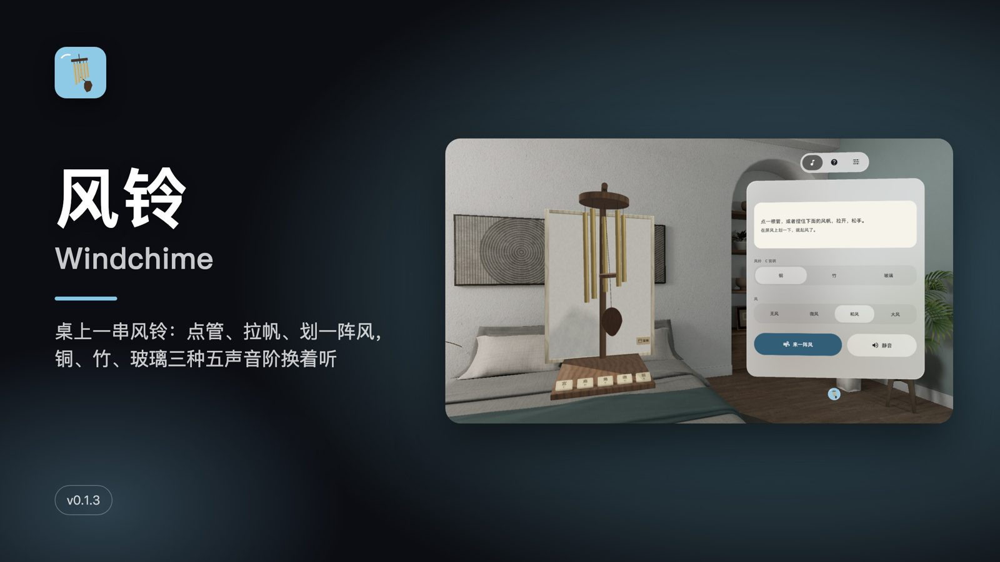

[中文](#中文) · [English](#english)

## 中文

桌上一只胡桃木小架，背后一扇纸屏风，架上挂着一串五根管的风铃。点一根管它就响；捏住下面的风帆拉开、松手，整串荡起来，中间的木锤碰到哪根哪根响；在屏风前划一下，就是一阵风。

- **三种风铃**：黄铜（清亮、余音长）/ 竹（短促温和）/ 玻璃（高而清）；五根管是宫商角徵羽，没有半音，怎么碰都好听
- **怎么玩**：点管或点底座上的五块音名牌；捏住风帆拉开再松手；在纸屏风上划一下起风，或点「来一阵风」
- **风有四档**：无风 / 微风 / 和风 / 大风
- **声音**：真实的 CC0 录音（freesound.org、Kenney），按每根管的音高变调；混音总线让快速连敲同一根管时音量一致
- **体积可缩放**：风铃放在系统的立体窗口（Shared Space 体积）里，可拖动、等比缩放，内容和手势都跟着缩放
- **光照**：暖色方向光 + 环境光和材质亮度兜底
- **大风不卡**：物理在独立的 360 Hz 线程上按真实时钟走，系统把体积降到 10 fps 时风铃也不慢动作；碰撞声按发生时刻排进混音，不挤成一团（v0.1.3）
- 手势捏合 / 眼动 + 捏合 / 手柄射线；中英双语；全部本机运行，不联网、不需要账号

| | |
|---|---|
|  黄铜风铃 · 和风 | 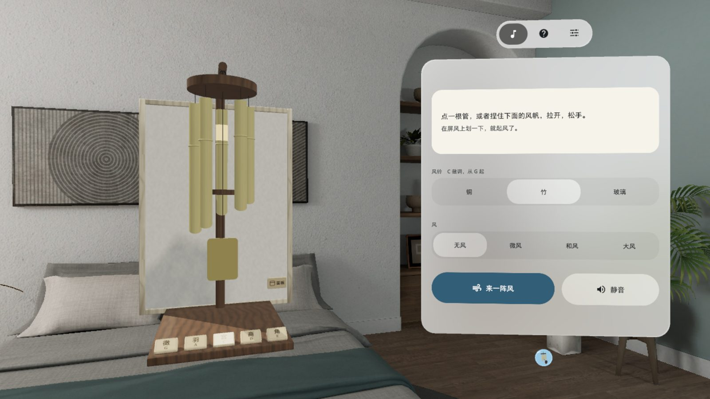 竹风铃：点音名牌「角」 |
| 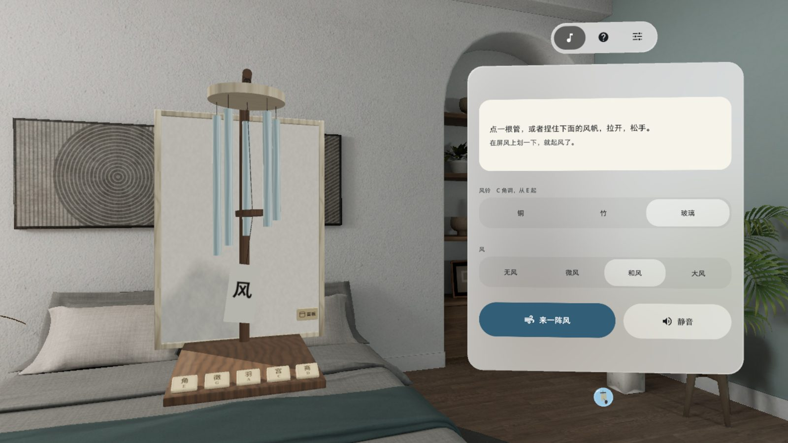 玻璃风铃 · 和风 | 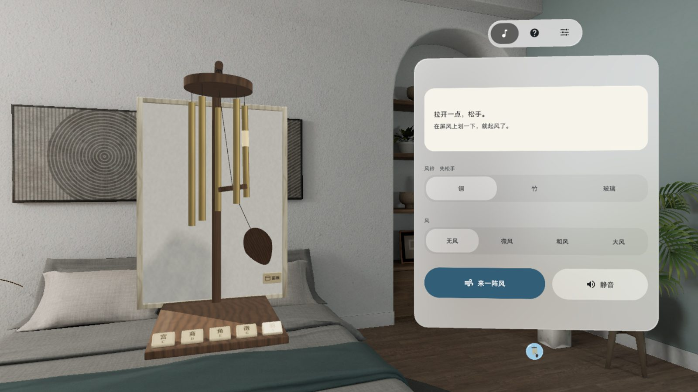 拉住风帆，松手整串荡起来 |
| 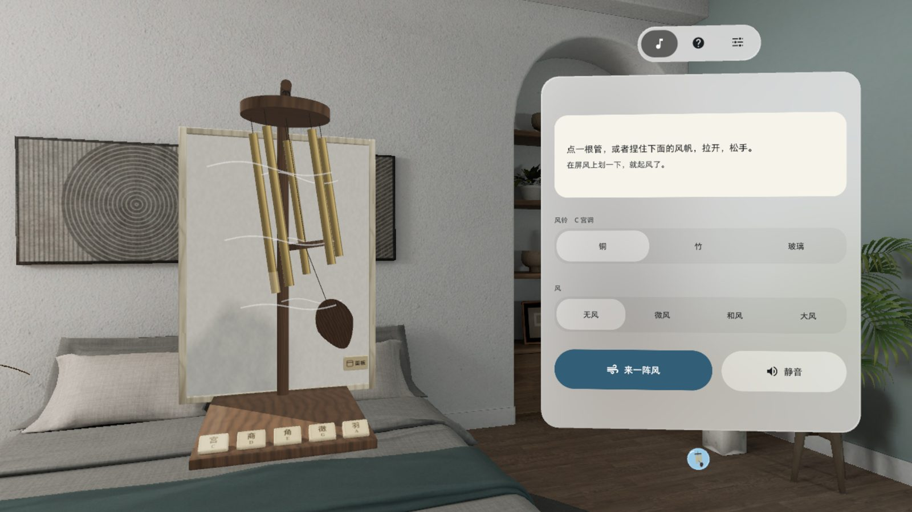 在屏风上划一阵风 | 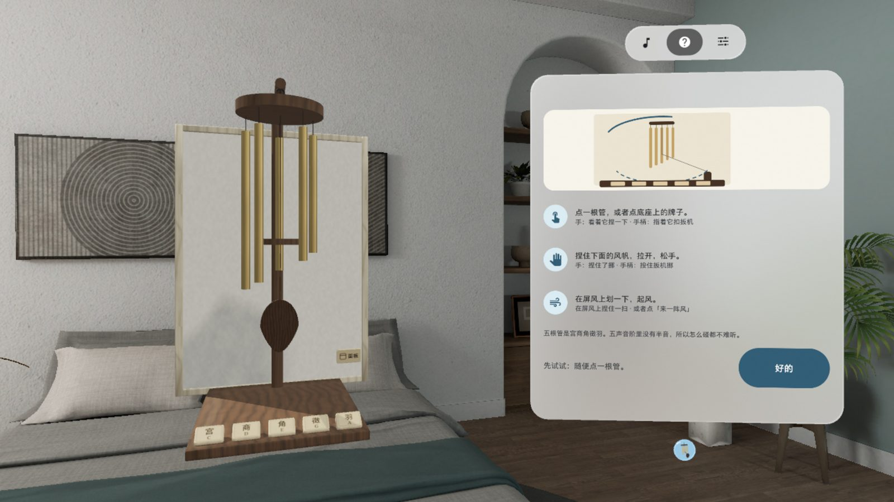 怎么玩 |
| 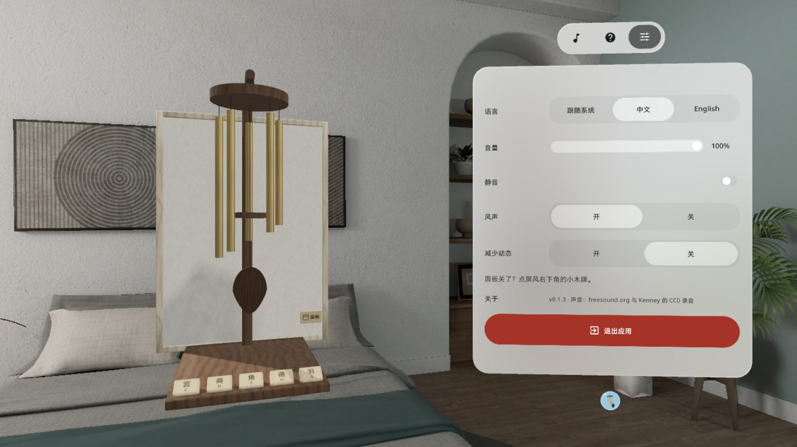 设置 | |

> 截图（v0.1.3 新拍）和演示视频（v0.1.2 录，画面与 v0.1.3 相同）都在 PICO 模拟器里拍，用调试广播驱动（模拟器发不出 3D 捏合 / 拖动），**非真实手势录像**；演示视频没有声音。

### 安装

从 [Releases](https://github.com/kejing-dev/WindChime/releases) 下载 `Windchime-v0.1.3.apk`（assembleRelease 未签名包，供商店重签名）。自己装到头显请用 debug 构建：

```bash
./gradlew assembleDebug
adb install -r app/build/outputs/apk/debug/app-debug.apk
pico-cli app launch io.embodit.windchime
```

需要 PICO OS 6（Android 15，minSdk 35），Spatial SDK 6.1.9。

### 已知问题（v0.1.3）

- 整机卡顿超过 0.25 s 时（比如系统抓取截图那几秒），物理按设计丢掉超出的积压：风铃停一下再接着走，不会慢动作
- 最暗的环境光下，木锤和屏风右下的小木牌接近黑色
- 启动时音频欠载几次后稳定（缓冲约 40 ms）
- 以下只在模拟器上验过，待真机确认：真机系统降帧时大风下的听感和动作、快速连敲的听感、黄铜 / 胡桃木在真实房间里的颜色、缩放后拉帆 / 划风是否跟手、手 / 手柄 / 眼手三种输入、点击到出声延迟

## English

A small walnut stand with a paper screen behind it and a five-tube wind chime, for PICO OS 6 Shared Space. Tap a tube and it rings; pinch the sail at the bottom, pull it back and let go, and the whole chime swings, the clapper ringing whatever it hits; swipe across the paper screen for a gust.

- **Three chimes**: brass (bright, long ring), bamboo (short, warm), glass (high, clear); five pentatonic notes, so nothing clashes
- **Play**: tap a tube or one of the five note tiles on the base; pull the sail and let go; swipe the screen or tap *Send a gust*
- **Four wind levels**: still / breeze / steady / gale
- **Sound**: real CC0 recordings (freesound.org, Kenney) pitched to each tube; a mix bus keeps fast repeated strikes at the same level
- **Resizable**: the chime lives in a system volume you can move and scale uniformly; content and gestures follow the size
- **Light**: a warm key light plus an ambient / material floor
- **Smooth in a gale**: physics runs on its own 360 Hz thread by the wall clock, so when the system drops the volume to 10 fps the chime keeps real speed; strike sounds are placed at the moment they happen instead of bunching up (v0.1.3)
- Hand pinch, gaze + pinch, controller ray; Chinese and English; fully offline, no account

| | |
|---|---|
| 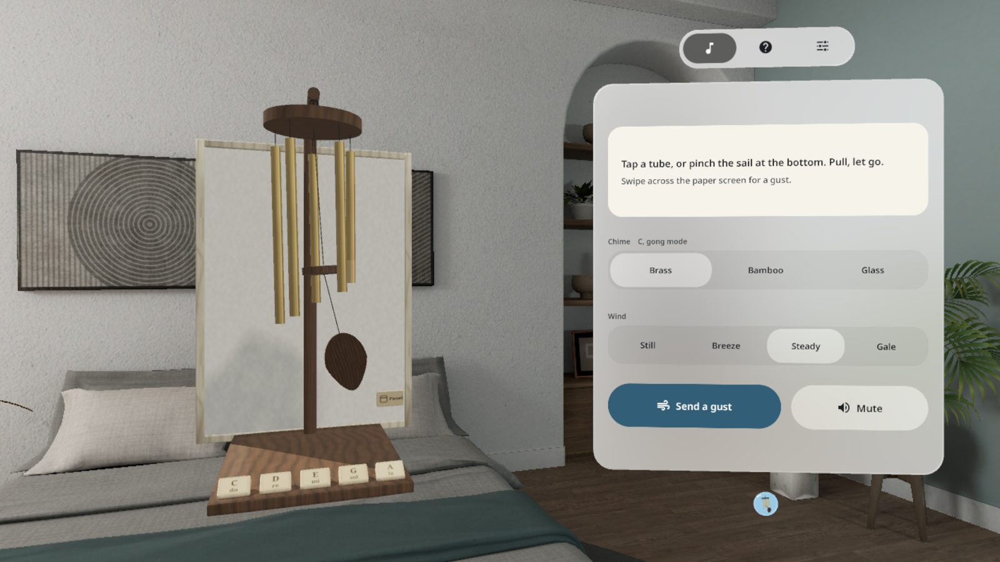 Brass, steady wind | 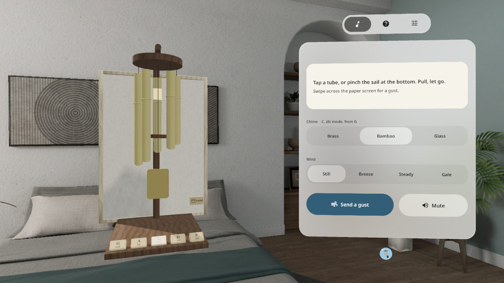 Bamboo: tap a note tile |
| 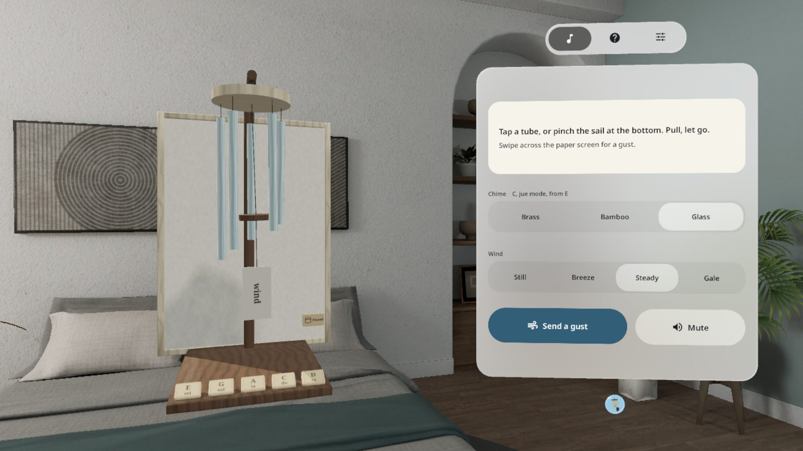 Glass, steady wind |  Pull the sail, let go |
| 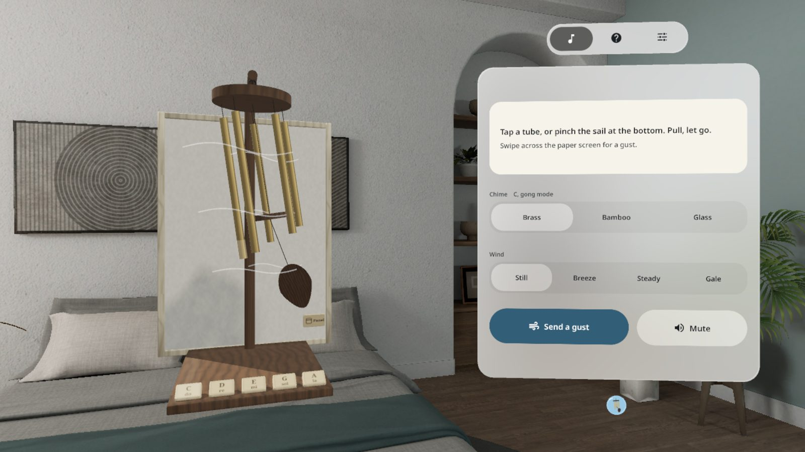 Swipe a gust | 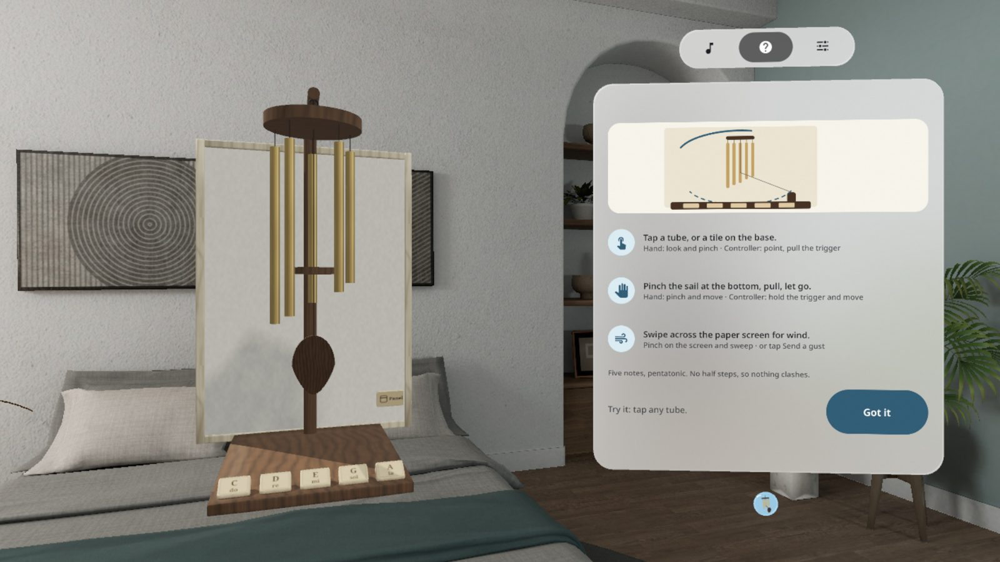 How to play |
| 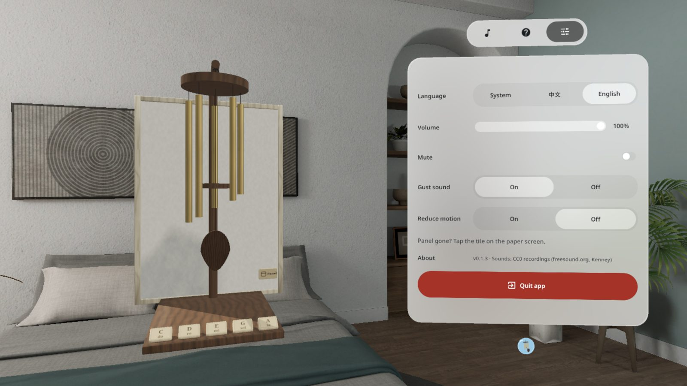 Settings | |

> Screenshots (v0.1.3) and the demo video (recorded on v0.1.2, same visuals) were captured on the PICO emulator, driven by a debug broadcast (the emulator can't send 3D pinches or drags): **not a real hand-gesture recording**. The demo video has no sound.

### Install

Download `Windchime-v0.1.3.apk` from [Releases](https://github.com/kejing-dev/WindChime/releases) (assembleRelease, unsigned, for store re-signing). To sideload on a headset, use a debug build:

```bash
./gradlew assembleDebug
adb install -r app/build/outputs/apk/debug/app-debug.apk
pico-cli app launch io.embodit.windchime
```

Requires PICO OS 6 (Android 15, minSdk 35), Spatial SDK 6.1.9.

### Known issues (v0.1.3)

- If the whole device stalls for more than 0.25 s (e.g. while the system grabs a screenshot), physics drops the backlog by design: the chime pauses briefly and carries on, never in slow motion
- In the darkest ambient light the clapper and the small wooden tile at the screen's lower right look almost black
- Audio underruns a few times at start, then holds (about 40 ms buffer)
- Verified on the emulator only, headset check pending: gale feel when the headset really drops the frame rate, feel of fast repeated strikes, brass / walnut colour in a real room, sail / gust after resizing, hand / controller / gaze input, tap-to-sound latency

## Build / 构建

```bash
export JAVA_HOME=<JDK 21>
./gradlew assembleDebug :app:testDebugUnitTest   # 58 unit tests
./gradlew assembleRelease                         # unsigned release APK
```

Code map, debug broadcast and screenshot list: [AGENTS.md](AGENTS.md). Changes: [CHANGELOG.md](CHANGELOG.md).

Sounds: CC0 (freesound.org, Kenney), see `tools/make_sounds.py`. Font: Noto Sans (SIL OFL 1.1), `third_party/noto-sans`.
